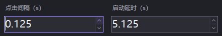

# 钰宇鼠标连点器 v1.5.1

2026/11/23，适用于 Windows 10/11 x64。

点击间隔、启动延时、重复轮数和 X、Y 坐标输入框的上下箭头已改为与石墨深色界面配套的样式。可直接键入数值，也可点击箭头增减。时间每次增减 0.1 秒，轮数和坐标每次增减 1。

| 发行版 | 使用方式 |
| --- | --- |
| [安装版](https://github.com/HQY-DEBUG/mouse_click/releases/download/v1.5.1/YuyuMouseClick-v1.5.1-win-x64-setup.exe) | 从托盘菜单退出旧版，然后运行安装程序升级。 |
| [便携版](https://github.com/HQY-DEBUG/mouse_click/releases/download/v1.5.1/YuyuMouseClick-v1.5.1-win-x64-portable.zip) | 完整解压到可写目录，运行其中的主程序。需要沿用便携设置时，将旧版的 `data` 目录复制到新版目录。 |

发行附件包含 SHA-256 校验值和构建来源清单。[验证记录](https://github.com/HQY-DEBUG/mouse_click/blob/main/docs/releases/validation-v1.5.1.md)
